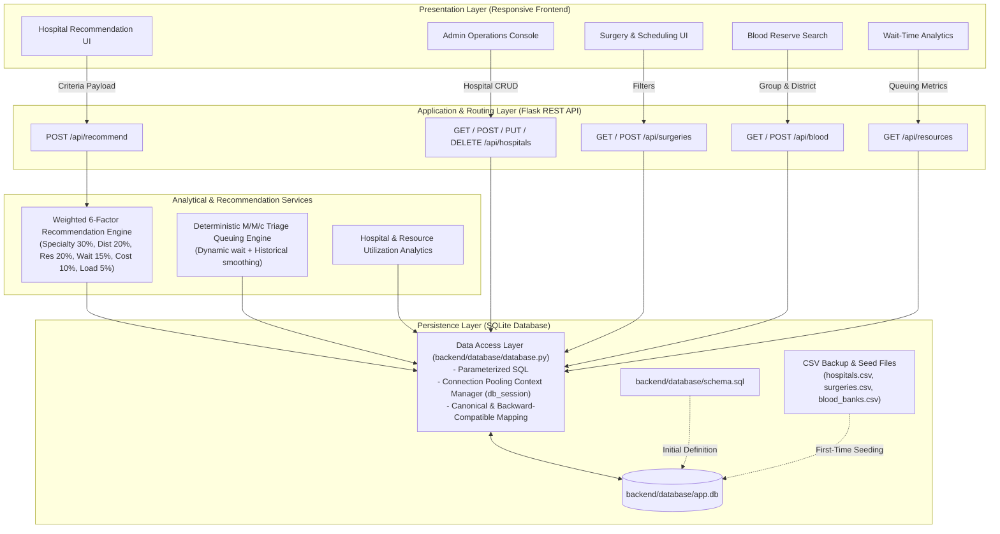

# SQLite Database Architecture & Data Access Layer (Phase 5)

**Project Title:** Real-Time Hospital Resource, Surgery and Blood Donation Recommendation System  
**Module:** Persistent Storage Engine & Admin CRUD Integration  
**Database Engine:** SQLite 3 (`backend/database/app.db`)  
**Design Paradigm:** Parameterized relational persistence with zero-latency reflection in recommendation scoring.

---

## 1. System Architecture Diagram



---

## 2. Relational Schema & Tables

### 2.1 Table: `hospitals`
Master registry for healthcare facilities.

| Column | Type | Constraints | Description |
| :--- | :--- | :--- | :--- |
| `id` | `TEXT` | `PRIMARY KEY` | Unique alphanumeric identifier (e.g. `H101`). |
| `name` | `TEXT` | `NOT NULL` | Registered hospital institution name. |
| `specialty` | `TEXT` | `NOT NULL` | Center of excellence / primary medical department. |
| `district` | `TEXT` | `NOT NULL` | Regional zone or metropolitan district. |
| `latitude` | `REAL` | `NOT NULL DEFAULT 12.9716` | Latitude coordinate for Haversine distance. |
| `longitude` | `REAL` | `NOT NULL DEFAULT 77.5946` | Longitude coordinate for Haversine distance. |
| `rating` | `REAL` | `DEFAULT 4.5` | Patient quality index (scale 1.0 to 5.0). |
| `total_beds` | `INTEGER` | `NOT NULL DEFAULT 100` | Total bed capacity of the hospital. |
| `available_beds` | `INTEGER` | `NOT NULL DEFAULT 20` | Real-time vacant general/acute beds. |
| `icu_total` | `INTEGER` | `NOT NULL DEFAULT 20` | Total intensive care unit beds. |
| `icu_available` | `INTEGER` | `NOT NULL DEFAULT 5` | Currently unreserved ICU/CCU beds. |
| `emergency_services` | `TEXT` | `DEFAULT 'Yes'` | Emergency trauma center indicator (`Yes` / `No`). |
| `emergency_load` | `TEXT` | `DEFAULT 'Medium'` | Current triage surge status (`Low`, `Medium`, `High`, `Critical`). |
| `standard_cost` | `INTEGER` | `DEFAULT 35000` | Baseline treatment cost (INR). |
| `average_wait_minutes`| `INTEGER` | `DEFAULT 30` | Historical baseline triage consultation wait (mins). |
| `queue_length` | `INTEGER` | `DEFAULT 10` | Active patient queue count in outpatient/triage. |
| `phone` | `TEXT` | `DEFAULT '+91-80-2800-0000'` | Emergency contact telephone number. |
| `address` | `TEXT` | `DEFAULT ''` | Physical facility street address. |
| `status` | `TEXT` | `DEFAULT 'Active'` | Operational status (`Active` / `Inactive`). |
| `created_at` | `TIMESTAMP`| `DEFAULT CURRENT_TIMESTAMP` | System creation timestamp. |
| `updated_at` | `TIMESTAMP`| `DEFAULT CURRENT_TIMESTAMP` | Last updated timestamp. |

*Indexes:*
- `idx_hospitals_specialty` ON `hospitals(specialty)`
- `idx_hospitals_district` ON `hospitals(district)`
- `idx_hospitals_status` ON `hospitals(status)`

---

### 2.2 Table: `surgeries`
Surgical procedures linked to hospitals.

| Column | Type | Constraints | Description |
| :--- | :--- | :--- | :--- |
| `id` | `TEXT` | `PRIMARY KEY` | Procedure code (e.g. `S201`). |
| `hospital_id` | `TEXT` | `NOT NULL, FK -> hospitals(id) ON DELETE CASCADE` | Linked hospital ID. |
| `surgery_name` | `TEXT` | `NOT NULL` | Name of surgical intervention. |
| `specialty` | `TEXT` | `NOT NULL` | Surgical clinical domain. |
| `estimated_cost` | `INTEGER` | `NOT NULL` | Procedure package cost (INR). |
| `average_wait_minutes`| `INTEGER` | `DEFAULT 30` | Average preparation time. |
| `waiting_days` | `INTEGER` | `DEFAULT 3` | Scheduled wait in days until operating theater slot. |
| `available_slots` | `INTEGER` | `DEFAULT 4` | Open operating theater slots this week. |
| `location` | `TEXT` | `DEFAULT ''` | Facility location/district. |
| `availability` | `TEXT` | `DEFAULT 'Available'` | Slot status. |
| `status` | `TEXT` | `DEFAULT 'Active'` | Procedure status. |

---

### 2.3 Table: `blood_banks`
Blood group reserves across facilities and district centers.

| Column | Type | Constraints | Description |
| :--- | :--- | :--- | :--- |
| `id` | `TEXT` | `PRIMARY KEY` | Blood bank record ID (e.g. `B301`). |
| `hospital_id` | `TEXT` | `FK -> hospitals(id) ON DELETE SET NULL` | Linked hospital (optional). |
| `name` | `TEXT` | `NOT NULL` | Blood center facility title. |
| `blood_group` | `TEXT` | `NOT NULL` | ABO/Rh group (`A+`, `A-`, `B+`, `B-`, `AB+`, `AB-`, `O+`, `O-`). |
| `units_available` | `INTEGER` | `NOT NULL DEFAULT 0` | Available tested units in storage. |
| `district` | `TEXT` | `NOT NULL` | Metropolitan district. |
| `contact` | `TEXT` | — | Contact telephone. |
| `last_updated` | `TEXT` | — | Inventory verification timestamp. |
| `status` | `TEXT` | `DEFAULT 'Active'` | Operational state. |

---

### 2.4 Table: `resources`
Granular medical inventory items per hospital.

| Column | Type | Constraints | Description |
| :--- | :--- | :--- | :--- |
| `id` | `TEXT` | `PRIMARY KEY` | Inventory item identifier (e.g. `RES-VENT-H101`). |
| `hospital_id` | `TEXT` | `NOT NULL, FK -> hospitals(id) ON DELETE CASCADE` | Registered hospital. |
| `resource_name` | `TEXT` | `NOT NULL` | Resource (e.g. Mechanical Ventilator, Oxygen Bed). |
| `resource_type` | `TEXT` | `NOT NULL` | Category (Critical Care, Inpatient, Specialized). |
| `total_quantity` | `INTEGER` | `NOT NULL` | Total installed equipment. |
| `available_quantity` | `INTEGER` | `NOT NULL` | Ready-to-deploy equipment. |
| `status` | `TEXT` | `DEFAULT 'Available'` | Status flag. |
| `last_updated` | `TEXT` | — | Verification timestamp. |

---

## 3. Database Initialization & Seeding Flow

1. **Auto-Discovery on Startup:**  
   When Flask starts or when `init_db()` is called, `backend/database/database.py` verifies whether `app.db` exists.
2. **DDL Execution:**  
   If tables do not exist, `backend/database/schema.sql` is executed with `PRAGMA foreign_keys = ON;`.
3. **Idempotent Seeding:**  
   The system queries `SELECT COUNT(*) FROM hospitals;`.
   - If count is `0`, baseline data is ingested from `backend/data/hospitals.csv`, `backend/data/surgeries.csv`, and `backend/data/blood_banks.csv`. Hospital resources are simultaneously generated.
   - If count is `> 0`, seeding is skipped to prevent duplicate records or overwriting runtime updates.
4. **Preservation of CSVs:**  
   Original CSV files are retained permanently in `backend/data/` as immutable seed blueprints and backup datasets.

---

## 4. Parameterized CRUD Flow & Connection Management

All database interactions utilize the `db_session` context manager:

```python
@contextmanager
def db_session(db_path=None):
    conn = get_db_connection(db_path)
    try:
        yield conn
        conn.commit()
    except Exception:
        conn.rollback()
        raise
    finally:
        conn.close()
```

- **Zero SQL Injection Risk:** All operations use parameterized query markers (`?`).
- **Automatic Resource Cleanup:** Connection closure is guaranteed even under unhandled exceptions, eliminating connection leakage and locks.
- **Foreign Key Cascades:** Deleting a hospital cascades to delete associated `surgeries` and `resources`, and unlinks `blood_banks`.

---

## 5. Real-Time Recommendation Data Flow

When an administrator updates hospital parameters through the Admin Portal (`PUT /api/hospitals/<id>`):

1. The client sends JSON payload to Flask (e.g. `{ "available_beds": 2 }`).
2. `update_hospital()` issues an atomic `UPDATE` query against `app.db`.
3. Subsequent user searches triggering `POST /api/recommend` invoke `get_all_hospitals()`, which immediately queries the SQLite table.
4. The recommendation engine evaluates the updated values without requiring server reboot or cache invalidation.

---

## 6. Testing Strategy & Isolation

The automated test suite (`tests/test_database.py`) provisions a temporary, isolated SQLite database via `tempfile.mkstemp()`, executes all 10 verification test cases, and removes the temporary file on test completion.

The production database `backend/database/app.db` remains pristine and protected during automated test execution.
